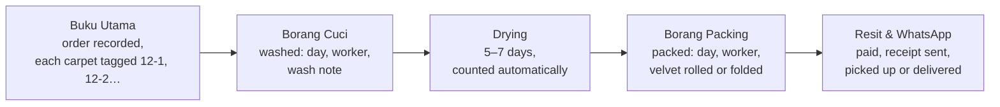
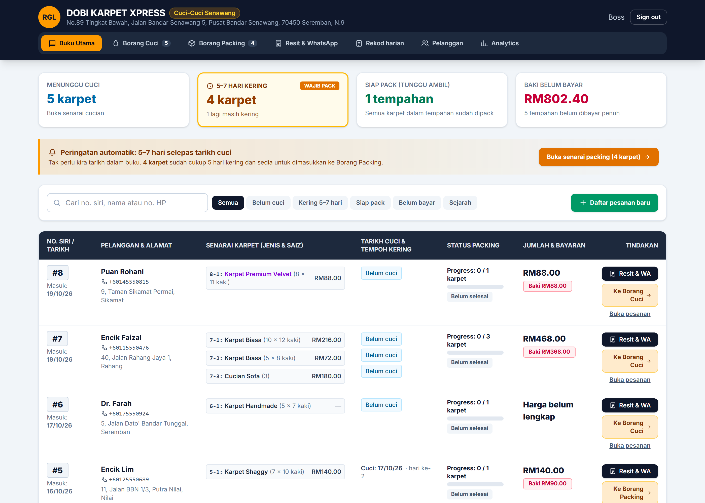
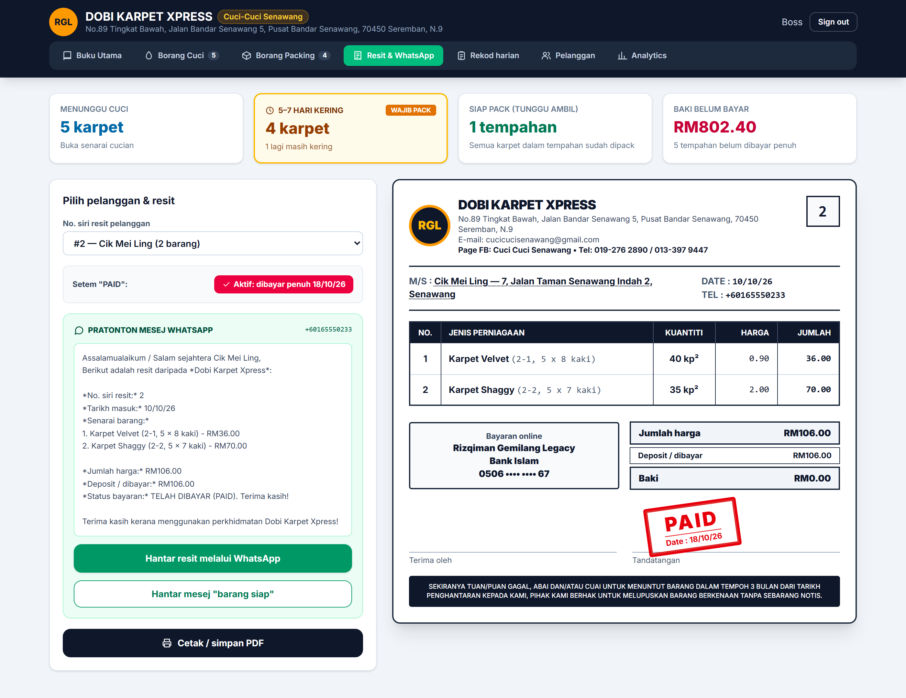
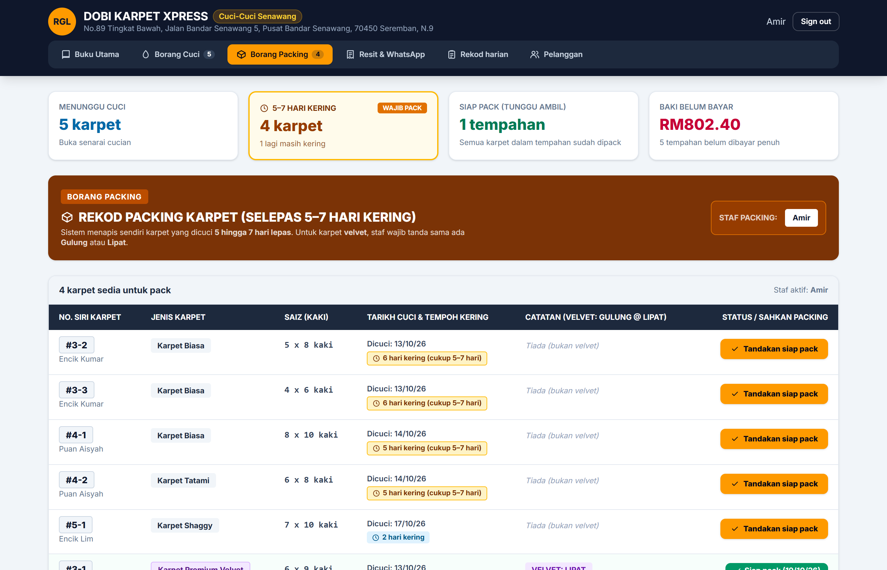
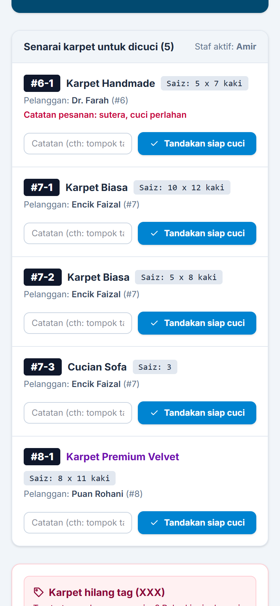
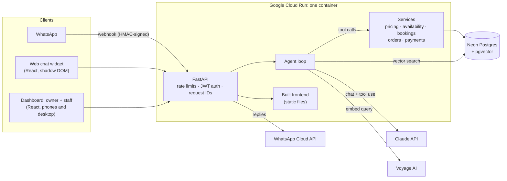
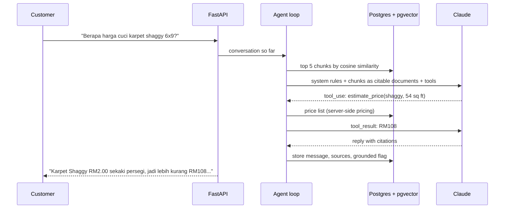

# Kilau AI Assistant

[](https://github.com/mhdhfzi/carpet-ai-assistant/actions/workflows/ci.yml)

An AI customer assistant and a back-office system for a small carpet-cleaning business in Malaysia.

- **The assistant:** customers chat on the website or WhatsApp, in English or Bahasa Melayu. It answers from the business's own documents with citations, prices jobs from the real price list, finds free slots and books them once the customer confirms.
- **The back office:** the owner and workers run the shop from their phones: orders, every carpet's washing and packing, payments, receipts and WhatsApp messages to customers. It replaces the paper book and forms the business used before.

**Live demo: https://kilau-918469824880.asia-southeast1.run.app**

- Chat: open the widget on the landing page (example questions in EN and BM are one click away).
- Owner dashboard: [`/admin.html`](https://kilau-918469824880.asia-southeast1.run.app/admin.html), **Try the demo account** (or `demo@example.com` / `kilau-demo-2026`). It is read-only and the data resets every night.
- Demo video: _to be added_

**In production for a real business:** the same code runs my family's carpet-cleaning business in Senawang, [Cuci-Cuci Senawang](https://cucicucisenawang.com) (trading as Dobi Karpet Xpress):

- the chat assistant on the website answers questions and gives price estimates, and sends customers to WhatsApp to book;
- the [back office](#back-office) gives the owner and five workers each their own login to record orders, track every carpet from washing to packing, take payments and send receipts.

See [One codebase, two deployments](#one-codebase-two-deployments).

> Kilau Carpet Care, the public demo, is fictional, so recruiters trying it never contact the real business. It's a portfolio project: applied AI (RAG + tool calling), backend engineering, cloud deployment and DevOps.

## The problem

A small cleaning business gets most of its enquiries on WhatsApp, often in the evening and in a mix of Malay and English. Most are the same few questions (how much for my carpet, are you open on Friday, can you come on Saturday), and the owner answers them one by one between jobs. Slow replies lose bookings, and nobody keeps track of what customers ask or which chats turn into work.

An assistant helps only if it can be trusted: it must never invent a price or a policy, must not book a slot that isn't free or that the customer didn't agree to, and must know when to pass the conversation to a person.

## What it does

| | |
|---|---|
| **Answers with sources** | Retrieval-augmented generation over the business's documents (services, pricing, FAQ, policies). Replies cite the passages they used; the owner sees the citations. A message that asks several things gets every part answered, and the model can search the documents again for anything still missing. |
| **Quotes and books** | Claude calls tools (`get_services`, `estimate_price`, `check_availability`, `prepare_booking`, `create_booking`) backed by tested business logic: price ranges, opening hours, Friday closing, 2 days' notice, one team, no double bookings. |
| **Confirms first** | `create_booking` takes no input: it books exactly what `prepare_booking` summarised, and only after a newer customer message (the confirmation). The model can't skip the step or change details on the way. |
| **Hands off** | Upset customers, out-of-scope requests and low-confidence answers go to the owner. Questions it couldn't answer are logged for the dashboard. |
| **Two channels** | An embeddable web widget (one `<script>` tag, shadow DOM) and a WhatsApp Business webhook (signature-verified, deduplicated). |
| **Owner dashboard** | Bookings with status changes, the chat behind each booking, and analytics: chat-to-booking conversion by channel, busy days, common topics, unanswered questions. |
| **Back office** | Orders, per-carpet washing and packing, payments, receipts and WhatsApp messages for a real business, with owner and staff roles. See [Back office](#back-office). |

## Back office

Before this system, the business ran on paper: a master book of orders, a washing form, a packing form filled in 5–7 days later once the carpets were dry, and a receipt sent to the customer on WhatsApp. The back office follows the same flow, one screen per paper form, in Bahasa Melayu, built for phones:



| | |
|---|---|
| **Orders (Buku Utama)** | Running order numbers with a tag per carpet. Sizes in feet are priced from the price list; handmade carpets wait for the owner to price them. Deposit, discount (owner only), notes. Search by number, tag, name or phone; filters for not washed, ready to pack, packed, unpaid and history. |
| **Every carpet tracked on its own** | Washed → drying → packed, each step with the day and the worker (from their own login). The order is ready only when every carpet is packed. Carpets washed 5 or more days ago appear on the packing list by themselves. |
| **Jobs at the customer's home** | Sofa, mattress and car seats are cleaned at the customer's house in one visit, so they skip the washing and packing forms: the order records the visit's date and time, a *Kerja Rumah* schedule lists today's, upcoming and unscheduled visits (with the address linked to Google Maps), and the job is simply marked done. An order is ready only when its carpets are packed and its home jobs are done. |
| **The forms' own rules** | Velvet must be packed rolled (*gulung*) or folded (*lipat*), and the server refuses it otherwise. A carpet that lost its tag ("XXX" on the paper form) is logged and matched back to its order later. |
| **Payments and receipts** | Deposit then balance, by cash, bank transfer or DuitNow. The receipt is laid out like the business's paper one. Its PAID stamp appears only when the recorded payments cover the total, so it can't be switched on by mistake. Ready-written WhatsApp messages for "your carpets are ready" and the receipt. |
| **Daily record** | Each day's washing and packing forms (who did what), printable. |
| **For the owner** | Summary cards (to wash, ready to pack, waiting for pickup, unpaid), customers with what they owe, and business analytics: money received by method, busy days, average days to finish. |

The screenshots use fictional customers in a local copy (the bank account is masked):

| Buku Utama: every order, its carpets and what's owed | Receipt, laid out like the paper one |
|---|---|
|  |  |

| Borang Packing: carpets dry enough to pack | Borang Cuci on a worker's phone |
|---|---|
|  |  |

**Roles.** Workers record orders, wash, pack and take payments. Prices, discounts, cancelling, moving a carpet back a step, voiding a payment and analytics are the owner's. Like the rest of the API, staff access is deny-by-default: only an explicit allow-list of routes is open to them, and a test enumerates every route to prove it.

### Design decisions (back office)

- **Order numbers never repeat**, even when two phones save at the same moment: creation takes a Postgres advisory lock, so the next number is read and written by one request at a time.
- **Prices are copied onto each item** when the order is recorded, so a later price-list change never rewrites an old receipt.
- **Money is never edited or deleted.** A wrong payment is voided by the owner with a reason and stays on record; orders are cancelled, not deleted; every step is logged with who did it and when.
- **The order follows its slowest carpet.** Its status is derived from its items, so it can't say "ready" while a carpet is still drying, and the rules hold whichever screen (or API client) is used.
- **Business rules live in the service layer, not the dashboard.** The velvet rule, the one-step-forward rule for staff and the balance check on payments are enforced by the server and covered by tests.
- **Off unless switched on.** The back office is a feature flag (`ORDERS_ENABLED`): the real business has it, the public demo doesn't. Database migrations only add tables and columns, so they run safely before the new code goes live.

## Screenshots

The conversations below are the seeded demo data that the live demo resets to every night, shown in the real widget and dashboard.

| Chat widget | Booking with its chat and citations |
|---|---|
|  |  |


## Architecture



One customer message, end to end:



### Design decisions

- **Prices come from code, not the model.** The model picks the service and the size; `estimate_price` computes the number from the database. A hallucinated price is impossible by construction, and the pricing rules have their own unit tests.
- **A hand-written agent loop behind a `ChatModel` interface.** Tools need request context (database session, conversation, which customer message is being answered), and the interface keeps the loop provider-neutral and testable with a scripted fake model. Capped at 6 tool rounds so a confused model can't loop (or bill) forever.
- **Booking confirmation enforced by the server, not the prompt.** Prompts are guidance; the rule "book only what the customer confirmed" is enforced in `create_booking` itself.
- **"Grounded" is a structured signal.** A reply counts as grounded if it cited the knowledge base or used a data tool. Ungrounded replies and hand-offs feed the unanswered-questions log, which shows the owner what to add to the documents.
- **Retrieval that doesn't lose questions.** Each customer message is searched as a whole, question by question, and together with the previous message (one embedding request), with the results interleaved so no single topic crowds out the rest. For run-on messages that can't be split, the model has a read-only `search_knowledge` tool to look up whatever the first search missed, instead of saying it doesn't know. Both fixes came from real conversations on the live site.
- **pgvector instead of a separate vector database.** Embeddings live next to the business data in Postgres (HNSW cosine index): one database to run, back up and migrate. Re-ingestion reuses embeddings for unchanged chunks.
- **No double bookings at the database level.** A Postgres exclusion constraint rejects overlapping visits even if two requests race past the application check.
- **Deny-by-default authorization.** Every route that isn't on an explicit public list needs a login, and the read-only demo role is refused every non-GET request in one place. Both rules are tested by enumerating every route in the OpenAPI schema, so a new endpoint can't be forgotten.
- **Costs are capped.** Per-IP rate limits on chat and login, a daily cap on AI replies (counted in the database, so it holds across instances), and Cloud Run scales from 0 to at most 2 instances.

## Tech stack

| Layer | Choice |
|---|---|
| Backend | Python 3.12, FastAPI, SQLAlchemy 2, Alembic, Pydantic v2 |
| Database | PostgreSQL + pgvector (Neon in production) |
| AI | Claude (tool calling, citations) via the Anthropic SDK; Voyage AI embeddings |
| Frontend | React 19, TypeScript, Vite, Tailwind CSS |
| Messaging | WhatsApp Business Cloud API |
| Auth | Argon2id password hashes, JWT (HS256) |
| Infra | Docker, GitHub Actions, Google Cloud Run, Artifact Registry, Secret Manager, Cloud Scheduler |
| Tests | pytest (430+ tests against a real Postgres), Vitest + Testing Library (75 tests) |

## Testing

- **Backend:** pytest against a real Postgres + pgvector (the same image as production). The tests cover pricing and availability rules, the agent loop with a scripted fake model (tool calls, confirmation step, hand-off, tool-round cap), the WhatsApp signature check and deduplication, auth (forged, expired and `alg: none` tokens, route protection), rate limits, the daily AI cap and a migration round-trip with a model/migration drift check. For the back office: order numbering, pricing and discounts, per-carpet steps and dates, the velvet rule, payments and voids, the summary numbers, and what staff may and may not do.
- **Frontend:** Vitest and Testing Library for the widget (sending, retrying, restoring history, the hand-off notice, keyboard use) and the dashboard (login, session expiry, filters, status changes, demo mode, charts with table views, and the back office's order, washing, packing and receipt screens).
- **CI:** every pull request runs lint, format check, type check, both test suites and a production image build.

## Running locally

Requires Docker, Python 3.12+ and Node.js 22+.

```bash
# Database (Postgres 16 + pgvector)
cp .env.example .env
docker compose up -d

# Backend
cd backend
cp .env.example .env            # then fill in JWT_SECRET and the API keys
python -m venv .venv
.venv/Scripts/activate        # Windows; use `source .venv/bin/activate` on macOS/Linux
pip install -e ".[dev]"
alembic upgrade head           # apply database migrations
python -m app.seed             # load the service price list (safe to re-run)
python -m app.ai.ingest        # embed knowledge docs + prices (needs VOYAGE_API_KEY in .env)
python -m app.create_owner owner@example.com "Owner Name"  # dashboard login (prompts for a password)
python -m app.create_owner worker@example.com "Worker" --staff  # a worker's login (back office)
python -m app.seed_demo        # optional: fictional chats and bookings, plus the read-only demo login
python -m app.ai.ask           # chat with the assistant in the terminal (needs ANTHROPIC_API_KEY)
ruff check . && ruff format --check .
pytest                         # needs the database running; uses a separate carpet_test DB
uvicorn app.main:app --reload  # API docs at http://127.0.0.1:8000/docs
                               # set ORDERS_ENABLED=true in .env for the back office
```

```bash
# Chat widget and owner dashboard (frontend/)
cd frontend
npm install
npm run dev                    # landing page at http://localhost:5173, dashboard at /admin.html
                               # (both proxy /api to the backend)
npm run lint && npm run typecheck && npm test
npm run build                  # -> dist/ (landing + dashboard) and dist/widget.js (embeddable)
```

Embed the widget on any site:

```html
<script src="https://<host>/widget.js" data-api="https://<backend>" data-offset-bottom="92" defer></script>
```

A page can also open it from its own button, optionally with a question typed in:

```js
window.dispatchEvent(new CustomEvent('kilau-chat:open', { detail: { message: 'How much for a sofa?' } }))
```

### Production image

One Docker image (multi-stage, non-root) runs the API and serves the built frontend from the same origin:

```bash
docker compose --profile app run --rm app alembic upgrade head   # migrations
docker compose --profile app up --build                          # http://localhost:8080
```

## Deployment (Google Cloud Run + Neon)

| Piece | Where |
|---|---|
| App (API + frontend) | Cloud Run service `kilau`, `asia-southeast1`, 0–2 instances (scales to zero) |
| Database | Neon Postgres (Singapore), pooled connection, pgvector |
| Images | Artifact Registry `asia-southeast1-docker.pkg.dev/kilau-assistant/kilau/app:<git sha>` |
| Secrets | Secret Manager: `database-url`, `jwt-secret`, `voyage-api-key`, `anthropic-api-key` |
| Migrations / one-off commands | Cloud Run jobs `migrate` (`alembic upgrade head`) and `manage` (`python -m ...`) |
| Nightly demo reset | Cloud Scheduler `demo-reset-nightly` (03:00 MYT) runs the `demo-reset` job: `python -m app.seed_demo --reset` |
| Real business | Cloud Run service `cuci-cuci` with jobs `cc-migrate` / `cc-manage`: its own Neon database, secrets (`cc-*`) and runtime account `cuci-run`. No reset job. Back office on (`ORDERS_ENABLED=true`), with the receipt's details as settings (`RECEIPT_NAME`, `BUSINESS_ADDRESS`, `BUSINESS_PHONES`, `PAYMENT_DETAILS`, `RECEIPT_TERMS`, …). |

**Continuous deployment.** On every push to `main`, CI runs the tests, then builds the image, pushes it, runs the `migrate` job and rolls Cloud Run onto the new image. Migrations run before the new code goes live, so they must stay compatible with the code still serving (add first, remove in a later release). GitHub authenticates through Workload Identity Federation (no stored key; only this repository is trusted) as `github-deployer`, which can push images and deploy but not read secrets. The app runs as `kilau-run`, which can only read its secrets.

**Public demo.** Owners have a role, and the auth dependency refuses every non-GET request from the `demo` role with 403. Because that login is public, the nightly reset deletes every customer, chat and booking and re-seeds the fictional demo data, so nothing a visitor types stays visible for more than a day.

Env vars, secrets and scaling belong to the service and carry over between deploys. To change them, or to run a one-off command against production:

```bash
gcloud run services update kilau --region asia-southeast1 --update-secrets ANTHROPIC_API_KEY=anthropic-api-key:latest
gcloud run jobs execute manage --region asia-southeast1 --args=-m,app.seed_demo --wait
```

**When the chat can't answer, it hides itself.** The widget asks `GET /api/chat/status` on every page load and shows its button only if the chat can answer. It can't when switched off (`CHAT_ENABLED=false`), when today's reply cap is reached, or when the AI account is out of credit: a `billing_error` from Claude pauses the chat (stored in the database, so every instance agrees). The pause ends by itself after 30 minutes and doubles each time in a row, up to 6 hours, so after a top-up the chat comes back without anyone doing anything. To bring it back straight away:

```bash
gcloud run jobs execute cc-manage --region asia-southeast1 --args=-m,app.chat_switch,resume --wait
```

Neon runs Postgres 18; CI tests against 16. The app uses nothing that differs between them.

### One codebase, two deployments

The same image runs twice, and configuration decides the business and what the assistant may do:

| | Portfolio demo (`kilau`) | Real business (`cuci-cuci`) |
|---|---|---|
| Business | Kilau Carpet Care (fictional) | Cuci-Cuci Senawang |
| Knowledge | `backend/knowledge/` | `backend/knowledge-cucicuci/` |
| Assistant | Quotes and takes bookings | Answers and estimates; bookings go to WhatsApp (`BOOKINGS_ENABLED=false`) |
| Where | Its own landing page | Embedded on cucicucisenawang.com (only that site may call it) |
| Back office | Off | On: orders, washing, packing, payments, receipts |
| Dashboard | Public read-only demo login, data reset nightly | Private logins (one owner, staff for each worker), real data kept |

The difference in what the assistant may do is enforced in code, not only in the prompt: in answers-only mode the booking tools are never offered to the model, and the server refuses them even if the model names one. The two deployments share nothing but the code and the AI keys: separate databases, secrets and runtime service accounts, so the public demo can't read the real business's data. `seed_demo` refuses to run when `DEMO_BUSINESS=false`, and a test checks the two knowledge bases never mention each other.
## What I'd improve next

- **Nightly database backups** for the real business (a dump to Cloud Storage, kept 30 days), and a monthly spreadsheet export the owner keeps himself.
- **Live updates in the back office**, so a page refreshes when another worker changes something, and password resets from the dashboard instead of the command line.
- **Linking the two halves:** a customer could ask the assistant on WhatsApp whether their carpets are ready, answered from the order's real status.
- **An evaluation set for the assistant.** The agent is tested with a scripted fake model, which proves the plumbing but not the answers. Next: a fixed set of real-style questions in BM, EN and a mix of both, with expected facts, tool calls and hand-offs, scored automatically on every prompt or model change.
- **Hybrid retrieval.** Add keyword search alongside vectors, so exact service names and Malay spelling variants ("tilam", "tilam queen", "mattress") match reliably.
- **Streaming replies** in the widget (server-sent events), so long answers start appearing at once.
- **Replying from the dashboard** after a hand-off, instead of the owner switching to WhatsApp.
- **WhatsApp templates** for booking confirmations and next-day reminders (messages outside the 24-hour window need approved templates).
- **A shared rate-limit store** (Redis) if the service ever runs more than a couple of instances; limits are per instance today.
- **Infrastructure as code** (Terraform) for the Cloud Run, IAM and scheduler setup, which is currently a documented series of `gcloud` commands, plus a staging environment.
- **Tracing and alerts:** OpenTelemetry traces across the agent loop and alerts on error rate and AI spend.
